# JavaScript · Node.js · MongoDB — Brief Topics with Flowcharts (2026)

> Visual companion to [`interview-prep-2026.md`](./interview-prep-2026.md).  
> Each topic: **2–3 sentence brief** + **Mermaid flowchart** for interview revision.

---

## How to Use This Guide

| Experience | Read these parts | Focus |
|------------|------------------|-------|
| **0–2 years** | [Part I](#part-i--javascript-fundamentals) · [Part II](#part-ii--nodejs-fundamentals) · [Part III](#part-iii--mongodb) | Core JS, Express, MongoDB CRUD |
| **2–4 years** | Parts I–III + [Part IV](#part-iv--full-stack-flows) | Auth, caching, checkout, queues |
| **5–6 years** | Parts I–IV + [Part V](#part-v--senior-javascript--nodejs-6-years) + [Part VI](#part-vi--senior-system-design--architecture-5-years) | Deep JS/Node runtime + system design |
| **6+ years** | All parts — prioritize **Part V** for JS/Node depth | Production patterns, architecture tradeoffs |

**Format:** Each entry is a numbered **topic** (e.g. **Topic 26**). Use the number to find sections and in the quick-reference tables below.

---

## Table of Contents

### [Part I — JavaScript Fundamentals](#part-i--javascript-fundamentals) · Topics 1–8

| No. | Topic |
|---|-------|
| [1](#1-event-loop--call-stack-to-callbacks) | Event Loop — Call Stack to Callbacks |
| [2](#2-microtasks-vs-macrotasks) | Microtasks vs Macrotasks |
| [3](#3-promise-lifecycle) | Promise Lifecycle |
| [4](#4-async--await-flow) | async / await Flow |
| [5](#5-hoisting--temporal-dead-zone-tdz) | Hoisting & TDZ |
| [6](#6-prototype-chain-lookup) | Prototype Chain |
| [7](#7-closure--lexical-scope-chain) | Closures |
| [8](#8-event-propagation-browser) | Event Propagation (Browser) |

### [Part II — Node.js Fundamentals](#part-ii--nodejs-fundamentals) · Topics 9–15, 26–27

| No. | Topic |
|---|-------|
| [9](#9-nodejs-event-loop--six-phases) | Node Event Loop — Six Phases |
| [10](#10-http-request-lifecycle-express) | Express Request Lifecycle |
| [11](#11-jwt-authentication-flow) | JWT Authentication |
| [12](#12-session-vs-jwt) | Session vs JWT |
| [13](#13-oauth-20--authorization-code--pkce) | OAuth 2.0 + PKCE |
| [14](#14-nodejs-streams-pipeline) | Streams Pipeline |
| [15](#15-cluster--worker-threads-overview) | Cluster / Worker Threads |
| [26](#26-error-handling-middleware) | Error Handling Middleware |
| [27](#27-nosql-injection-prevention) | NoSQL Injection Prevention |

### [Part III — MongoDB](#part-iii--mongodb) · Topics 16–22

| No. | Topic |
|---|-------|
| [16](#16-mongodb-crud-path) | CRUD Path |
| [17](#17-index-selection--query-plan) | Index Selection |
| [18](#18-aggregation-pipeline) | Aggregation Pipeline |
| [19](#19-embedding-vs-referencing) | Embed vs Reference |
| [20](#20-transactions-multi-document-acid) | Transactions |
| [21](#21-replication--read-concern) | Replication |
| [22](#22-sharding-horizontal-scale) | Sharding |

### [Part IV — Full-Stack Flows](#part-iv--full-stack-flows) · Topics 23–25, 28

| No. | Topic |
|---|-------|
| [23](#23-e-commerce-order-checkout) | Order Checkout |
| [24](#24-caching-with-redis) | Caching with Redis |
| [25](#25-rate-limiting) | Rate Limiting |
| [28](#28-message-queue--async-jobs) | Message Queue / Async Jobs |

### [Part V — Senior JavaScript & Node.js (6+ Years)](#part-v--senior-javascript--nodejs-6-years) · Topics 51–75

| No. | Topic |
|---|-------|
| [51](#51-this-binding--four-rules) | `this` Binding |
| [52](#52-call-vs-apply-vs-bind) | call / apply / bind |
| [53](#53-class-inheritance--extends--super) | Class Inheritance |
| [54](#54-promiseall-vs-allsettled-vs-race-vs-any) | Promise.all / race / any |
| [55](#55-processnexttick-vs-setimmediate-vs-settimeout) | nextTick vs setImmediate |
| [56](#56-browser-vs-node-event-loop) | Browser vs Node Event Loop |
| [57](#57-esm-vs-commonjs--module-loading) | ESM vs CommonJS |
| [58](#58-memory-leaks-in-javascript) | Memory Leaks |
| [59](#59-garbage-collection--mark-and-sweep) | Garbage Collection |
| [60](#60-debounce-vs-throttle) | Debounce vs Throttle |
| [61](#61-generators--yield--iterator-protocol) | Generators |
| [62](#62-proxy--intercept-object-operations) | Proxy |
| [63](#63-abortcontroller--cancel-async-work) | AbortController |
| [64](#64-eventemitter--pubsub-in-node) | EventEmitter |
| [65](#65-stream-backpressure) | Stream Backpressure |
| [66](#66-cluster-vs-worker-threads) | Cluster vs Worker Threads |
| [67](#67-uncaughtexception-vs-unhandledrejection) | uncaughtException vs unhandledRejection |
| [68](#68-refresh-token-rotation) | Refresh Token Rotation |
| [69](#69-express-async-error-handling) | Express Async Errors |
| [70](#70-input-validation-pipeline) | Input Validation |
| [71](#71-blocking-the-event-loop--diagnosis) | Blocking Event Loop |
| [72](#72-middleware-order--common-mistakes) | Middleware Order |
| [73](#73-nestjs-request-lifecycle-overview) | NestJS Lifecycle |
| [74](#74-dependency-injection-in-node) | Dependency Injection |
| [75](#75-structured-clone-vs-jsonparsestringify) | structuredClone vs JSON |

### [Part VI — Senior System Design & Architecture (5+ Years)](#part-vi--senior-system-design--architecture-5-years) · Topics 29–50

| No. | Topic |
|---|-------|
| [29](#29-system-design-interview--step-by-step) | System Design Approach |
| [30](#30-cache-aside-vs-write-through-vs-read-through) | Cache Patterns |
| [31](#31-mongodb-vs-postgresql--when-to-use-which) | Mongo vs Postgres |
| [32](#32-horizontal-scaling--stateless-node-cluster) | Horizontal Scaling |
| [33](#33-idempotency-for-payments--webhooks) | Idempotency |
| [34](#34-cap-theorem--practical-tradeoffs) | CAP Theorem |
| [35](#35-saga-pattern--distributed-transactions) | Saga Pattern |
| [36](#36-circuit-breaker--fail-fast) | Circuit Breaker |
| [37](#37-websocket-at-scale--redis-adapter) | WebSocket at Scale |
| [38](#38-webhook-delivery-system) | Webhook Delivery |
| [39](#39-monolith-vs-microservices-vs-modular-monolith) | Monolith vs Microservices |
| [40](#40-event-driven-architecture) | Event-Driven Architecture |
| [41](#41-cqrs--command-vs-query-split) | CQRS |
| [42](#42-api-gateway-pattern) | API Gateway |
| [43](#43-zero-downtime-deployment) | Zero-Downtime Deploy |
| [44](#44-cicd-pipeline-for-node-apis) | CI/CD Pipeline |
| [45](#45-distributed-tracing--opentelemetry) | OpenTelemetry |
| [46](#46-testing-pyramid--senior-expectations) | Testing Pyramid |
| [47](#47-connection-pool-exhaustion) | Connection Pool Exhaustion |
| [48](#48-rag-pipeline--llm-with-your-data) | RAG Pipeline |
| [49](#49-dead-letter-queue-dlq-handling) | Dead Letter Queue |
| [50](#50-graceful-shutdown--production-node) | Graceful Shutdown |

### [Appendix](#appendix--quick-reference)

- [Quick Reference by Interview Question](#quick-reference-by-interview-question)
- [Topic Index by Technology](#topic-index-by-technology)

---

# Part I — JavaScript Fundamentals

> Core language concepts — event loop, async, scope, prototypes. Maps to **Q 1–20, 71–79** in [`interview-prep-2026.md`](./interview-prep-2026.md).

---

## 1. Event Loop — Call Stack to Callbacks

JavaScript runs synchronously on a single call stack. When async work finishes, callbacks land in task queues; the event loop moves them to the stack only when the stack is empty. This is why `setTimeout(fn, 0)` never runs before the current synchronous code.

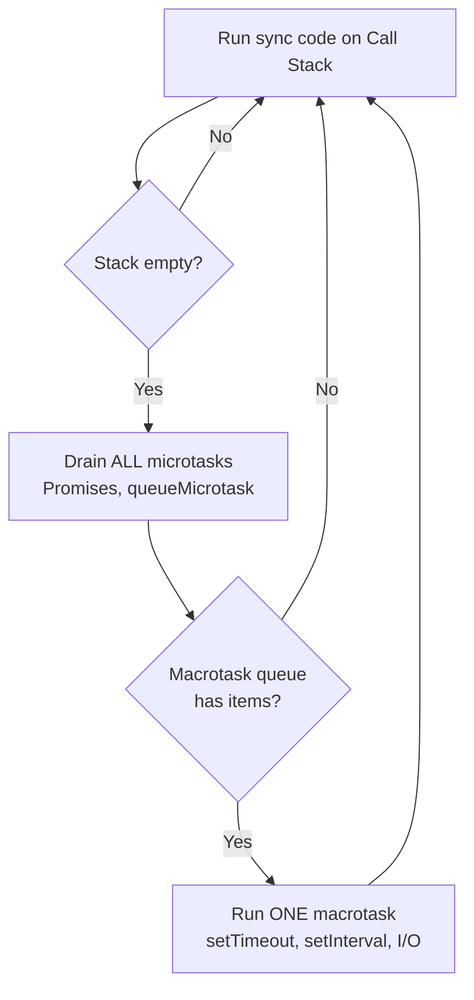

---

## 2. Microtasks vs Macrotasks

Microtasks (Promises, `queueMicrotask`) always run before the next macrotask. Macrotasks (`setTimeout`, DOM events, I/O) run one at a time per loop turn. Output `1, 4, 3, 2` for sync → Promise → setTimeout ordering.

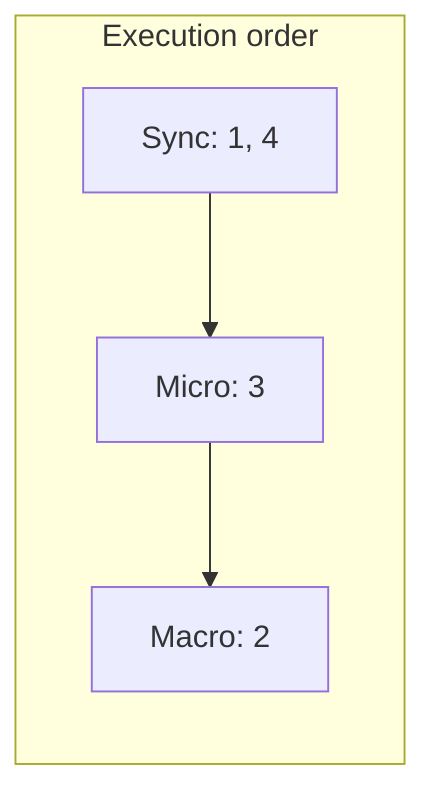

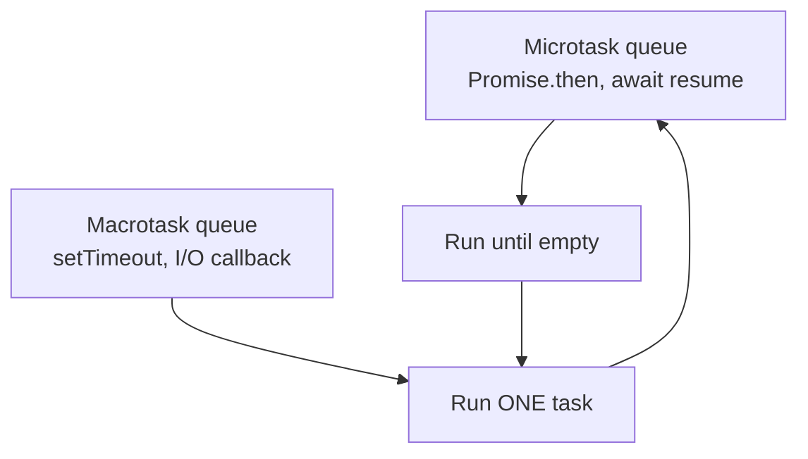

---

## 3. Promise Lifecycle

A Promise starts **pending**, then settles to **fulfilled** (value) or **rejected** (reason). `.then` / `.catch` register handlers; settled Promises run handlers as microtasks.

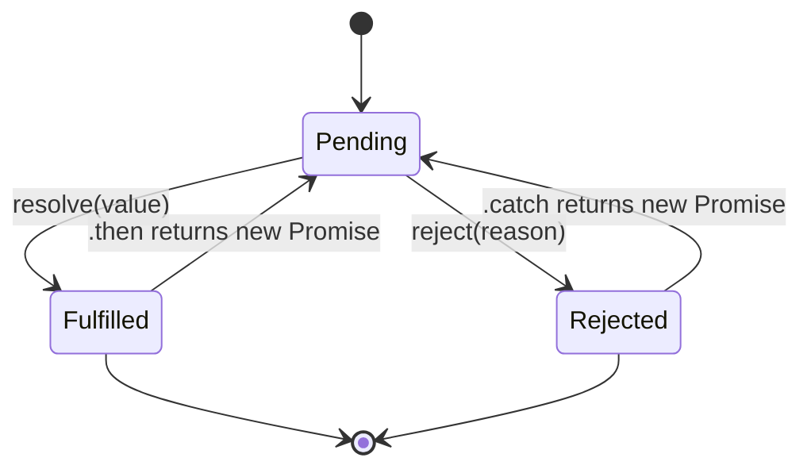

---

## 4. async / await Flow

`async` functions always return a Promise. `await` pauses the function until the Promise settles, then resumes as a microtask. Errors in `await` can be caught with try/catch inside the async function.

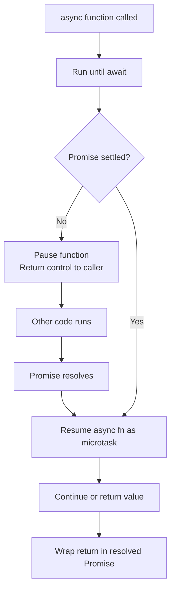

---

## 5. Hoisting & Temporal Dead Zone (TDZ)

Declarations are hoisted, but `let`/`const` stay uninitialized until their line runs — the TDZ. Accessing them before declaration throws `ReferenceError`. `var` is hoisted as `undefined`.

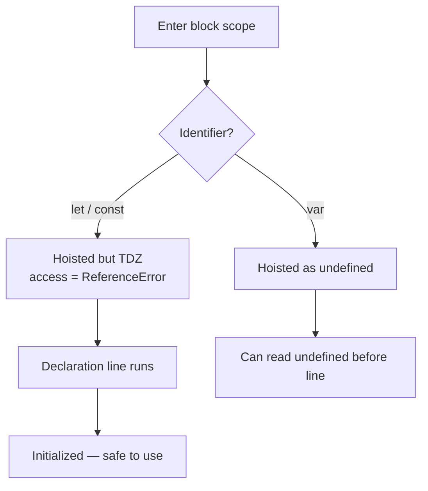

---

## 6. Prototype Chain Lookup

Objects delegate property lookup to their `[[Prototype]]` (via `__proto__` or `Object.getPrototypeOf`). If not found on the object, JavaScript walks the chain until `null`.

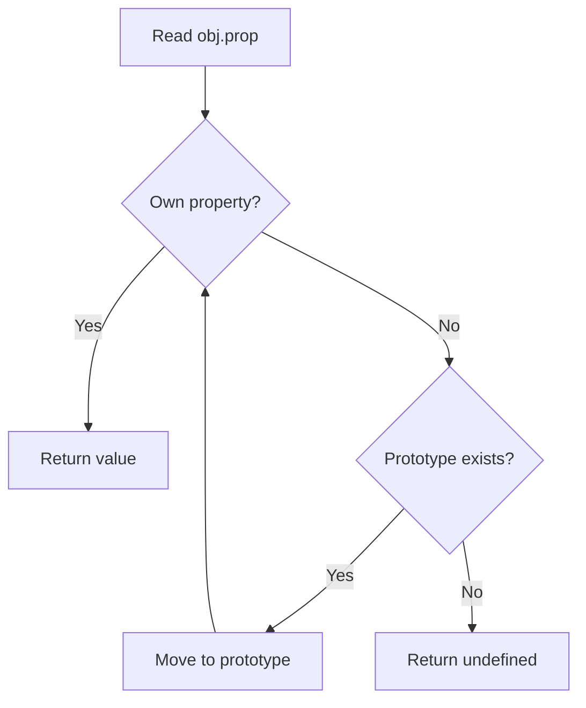

---

## 7. Closure — Lexical Scope Chain

A closure is a function plus its remembered lexical environment. Inner functions keep access to outer variables even after the outer function returns.

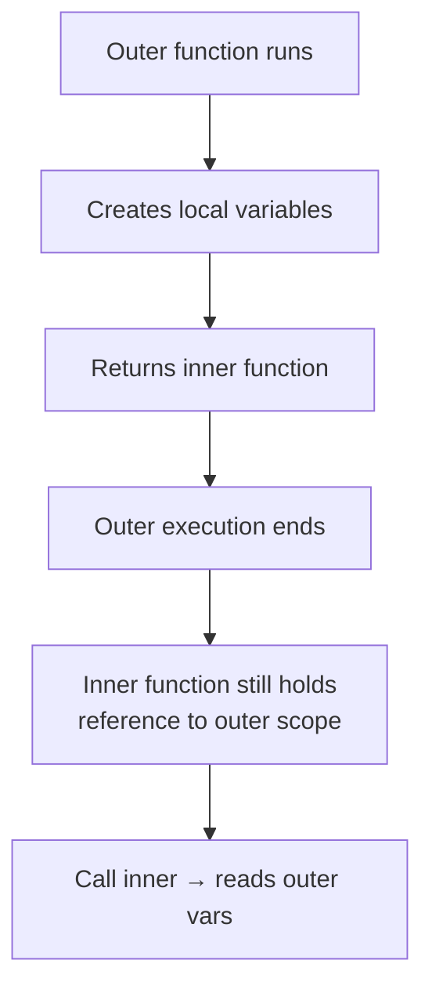

---

## 8. Event Propagation (Browser)

DOM events flow: **capture** (window → target), **target**, then **bubble** (target → window). `stopPropagation()` stops further propagation; `preventDefault()` stops default browser behavior.

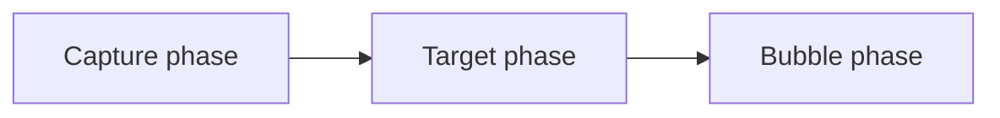

---

# Part II — Node.js Fundamentals

> Runtime, Express, auth, streams, and production security. Maps to **Q 80–128, 150–157** in [`interview-prep-2026.md`](./interview-prep-2026.md).

---

## 9. Node.js Event Loop — Six Phases

Node extends the browser model with libuv phases: timers, pending callbacks, idle/prepare, poll, check, close callbacks. `process.nextTick` and microtasks run between phases.

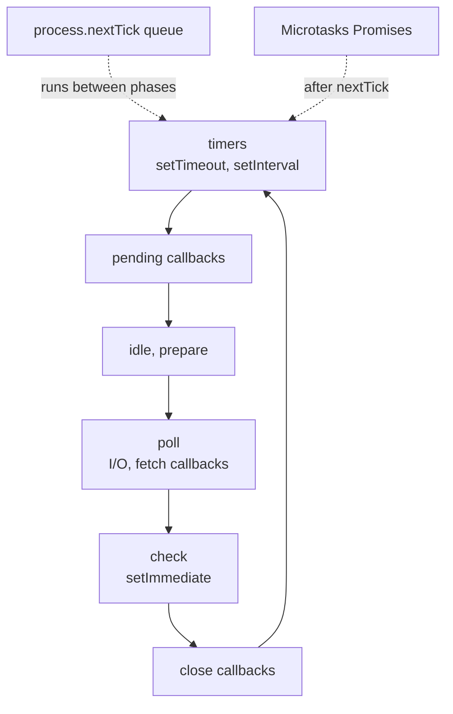

---

## 10. HTTP Request Lifecycle (Express)

A client request passes through middleware, route handlers, and optional error middleware before a response is sent. Order of `app.use()` registration defines the pipeline.

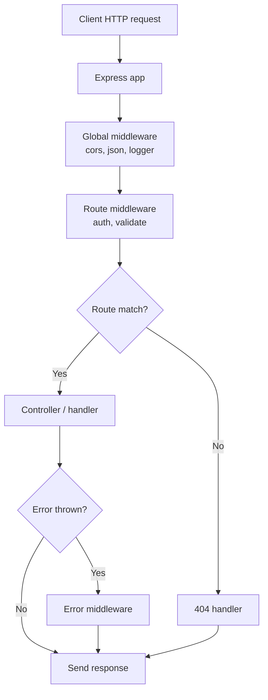

---

## 11. JWT Authentication Flow

User logs in with credentials; server returns a signed JWT. Client sends `Authorization: Bearer <token>` on each request; server verifies signature and expiry before granting access.

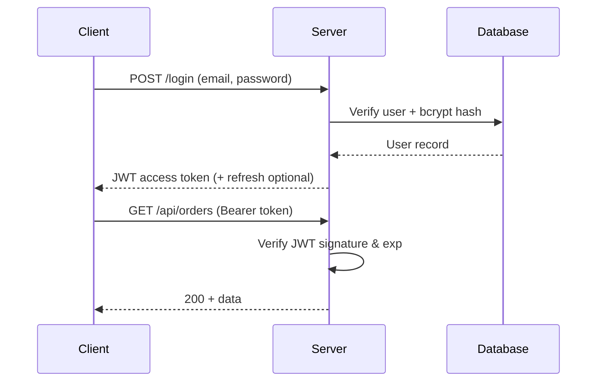

---

## 12. Session vs JWT

**Sessions** store state server-side; cookie holds session ID. **JWT** is stateless — claims live in the token. Sessions are easy to revoke; JWTs scale horizontally but need short expiry + refresh tokens.

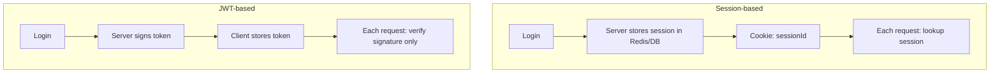

---

## 13. OAuth 2.0 — Authorization Code + PKCE

User authorizes via identity provider; app receives a code and exchanges it for tokens. PKCE adds a code challenge so public clients (SPAs, mobile) cannot have secrets stolen.

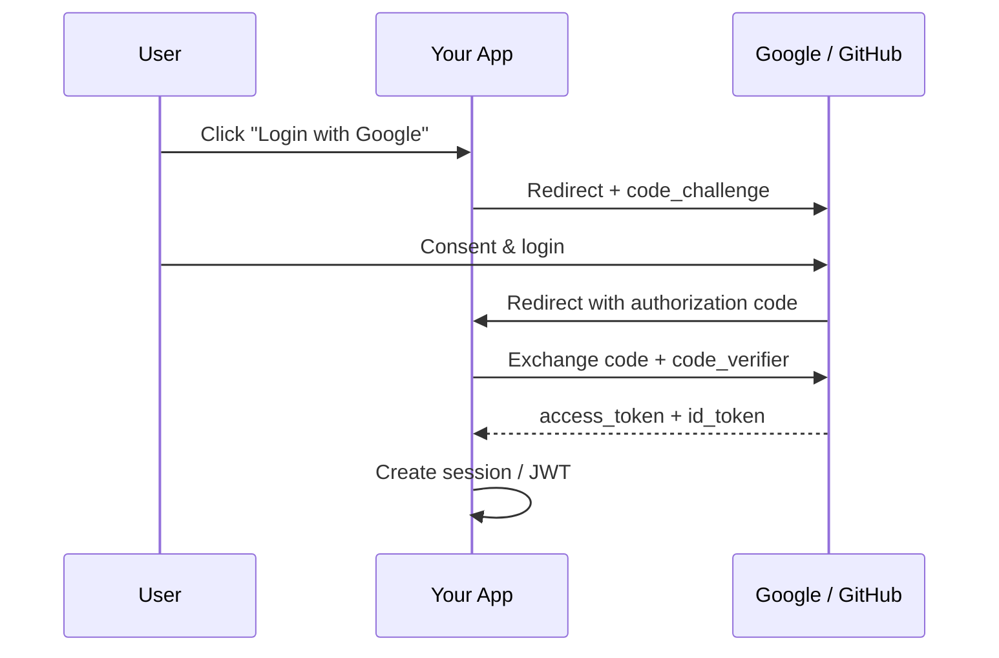

---

## 14. Node.js Streams Pipeline

Streams process data in chunks — useful for large files, HTTP bodies, and transforms. `pipeline()` forwards errors and cleans up on failure.

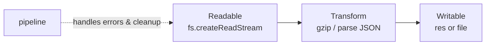

---

## 15. Cluster / Worker Threads (Overview)

**Cluster** forks processes to use multiple CPU cores for HTTP. **Worker threads** run CPU-heavy JS in parallel threads with shared memory options. I/O-bound apps benefit from async; CPU-bound work needs workers. See [Topic 66](#66-cluster-vs-worker-threads) for the senior decision flow.

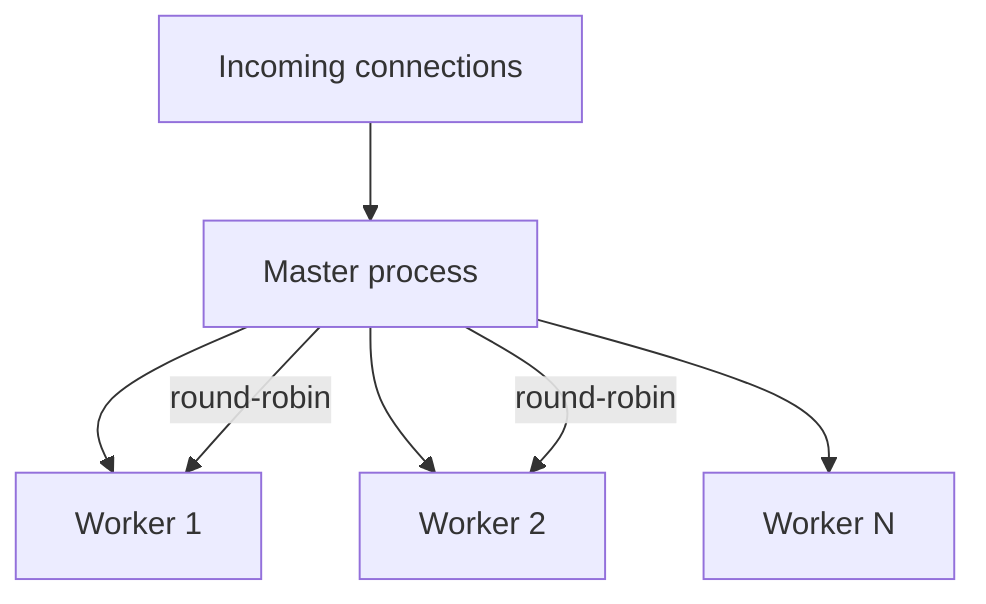

---

## 26. Error Handling Middleware

Synchronous errors in route handlers should reach Express error middleware via `next(err)`. Async errors need `try/catch` or a wrapper that calls `next(err)`. See also [Topic 69](#69-express-async-error-handling) for Express 4 vs 5.

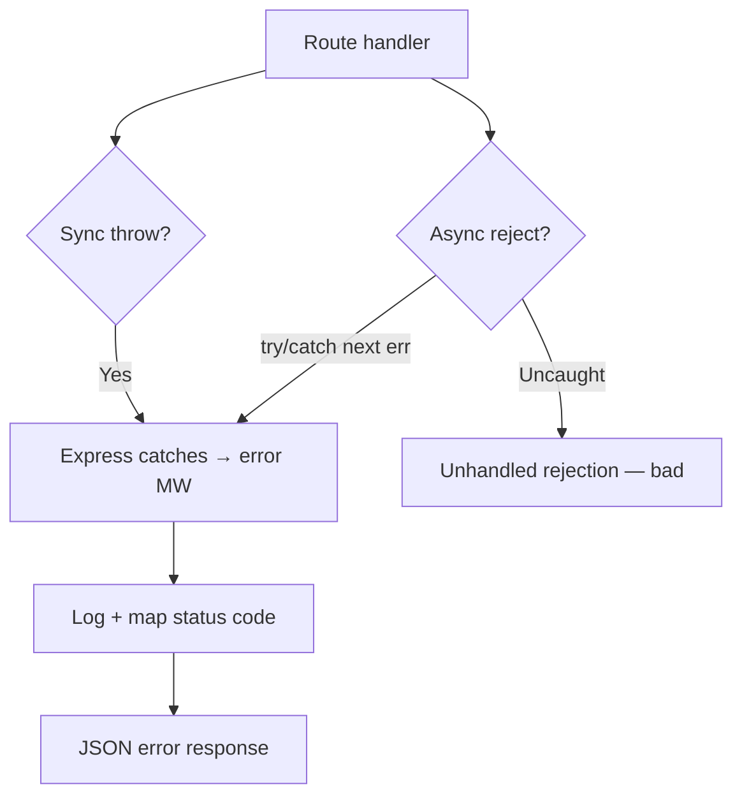

---

## 27. NoSQL Injection Prevention

Never pass raw user input into query operators. Validate types, use parameterized queries / Mongoose casting, and block `$`-prefixed keys in user objects.

```mermaid
flowchart TD
    A[User input: email, filter] --> B[Schema validation / zod]
    B --> C[Reject keys starting with $]
    C --> D[Typed query: findOne email string]
    D --> E[Safe execution]
    A -->|Bad: body = username[$gt]=''| F[Block before query]
```

---

# Part III — MongoDB

> Data modeling, queries, indexes, and scaling. Maps to **Q 158–225** in [`interview-prep-2026.md`](./interview-prep-2026.md).

---

## 16. MongoDB CRUD Path

Application code uses driver or Mongoose → MongoDB routes to collection → uses indexes when available → returns documents or write result.

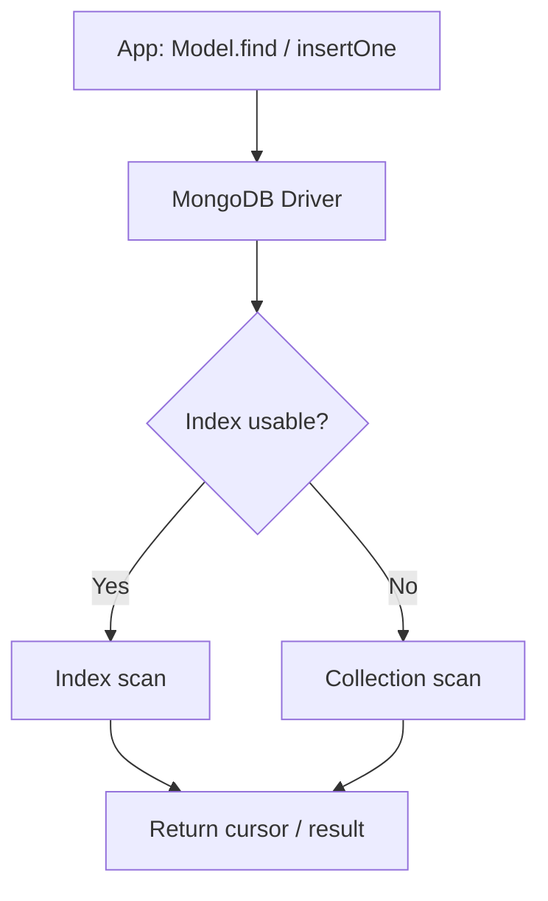

---

## 17. Index Selection & Query Plan

The query planner picks the best index or falls back to COLLSCAN. Use `explain()` to verify `IXSCAN` vs `COLLSCAN` in production tuning.

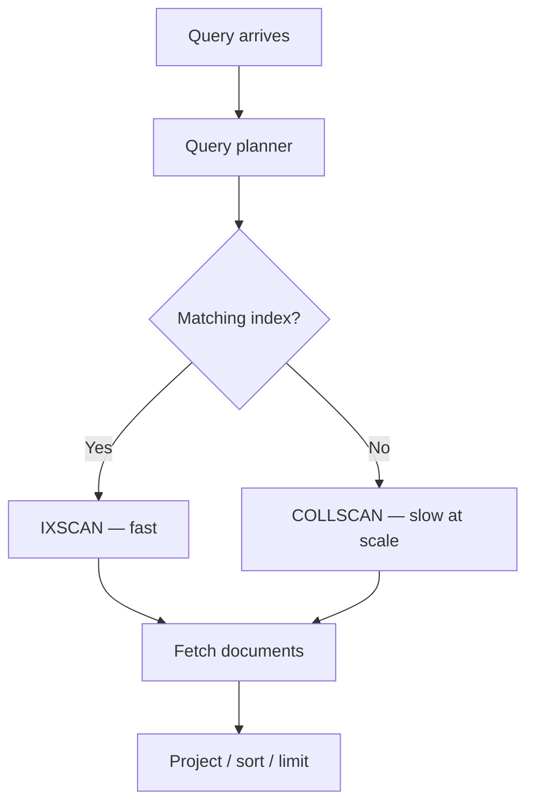

---

## 18. Aggregation Pipeline

Documents flow through ordered stages (`$match`, `$group`, `$lookup`, etc.). Each stage transforms the stream; early `$match` reduces data for performance.

```mermaid
flowchart LR
    A[$match<br/>filter docs] --> B[$lookup<br/>join collection]
    B --> C[$group<br/>aggregate]
    C --> D[$project<br/>shape output]
    D --> E[$sort / $limit]
    E --> F[Result cursor]
```

---

## 19. Embedding vs Referencing

**Embed** related data in one document for fast reads (1:few). **Reference** with `ObjectId` when data is large, shared, or updated independently (1:many, many:many).

```mermaid
flowchart TD
    A{Relationship?}
    A -->|1:few, read together| B[Embed subdocuments]
    A -->|1:many, shared, large| C[Reference ObjectId]
    A -->|many:many| D[Reference + junction or denormalize]
    B --> E[Single read — atomic updates harder]
    C --> F[populate / $lookup — normalized]
```

---

## 20. Transactions (Multi-Document ACID)

Start session → start transaction → multiple reads/writes → commit or abort. Required when updating multiple docs/collections atomically (e.g., debit + credit).

```mermaid
flowchart TD
    A[Start session] --> B[Start transaction]
    B --> C[Read / write ops]
    C --> D{All succeed?}
    D -->|Yes| E[commitTransaction]
    D -->|No| F[abortTransaction]
    E --> G[End session]
    F --> G
```

---

## 21. Replication & Read Concern

Primary accepts writes; secondaries replicate the oplog. Read concern controls whether reads see latest data or tolerate stale reads for scale.

```mermaid
flowchart LR
    W[Write to Primary] --> O[Oplog]
    O --> S1[Secondary 1]
    O --> S2[Secondary 2]
    R[Read preference] -->|primary| W
    R -->|secondary| S1
```

---

## 22. Sharding (Horizontal Scale)

MongoDB splits data across shards by shard key. `mongos` routes queries; each shard holds a subset of chunks.

```mermaid
flowchart TD
    A[Application] --> B[mongos router]
    B --> C{Shard key in query?}
    C -->|Targeted| D[Single shard]
    C -->|Scatter-gather| E[All shards]
    D --> F[Return merged results]
    E --> F
```

---

# Part IV — Full-Stack Flows

> End-to-end patterns combining Node, Redis, MongoDB, and queues. Maps to **Q 133–137, 232** in [`interview-prep-2026.md`](./interview-prep-2026.md).

---

## 23. E-Commerce Order Checkout

Typical flow: validate cart → reserve inventory → charge payment → create order → emit events → clear cart.

```mermaid
flowchart TD
    A[POST /checkout] --> B[Validate cart & auth JWT]
    B --> C{Stock available?}
    C -->|No| D[409 Out of stock]
    C -->|Yes| E[Payment gateway charge]
    E --> F{Payment OK?}
    F -->|No| G[402 / rollback reserve]
    F -->|Yes| H[MongoDB transaction:<br/>Order + Inventory update]
    H --> I[Publish order.created event]
    I --> J[201 + orderId]
```

---

## 24. Caching with Redis

Check cache first; on miss, query DB and populate cache with TTL. Invalidate on writes to avoid stale data.

```mermaid
flowchart TD
    A[GET /products/:id] --> B{Redis hit?}
    B -->|Yes| C[Return cached JSON]
    B -->|No| D[Query MongoDB]
    D --> E[SET redis key + TTL]
    E --> F[Return to client]
    G[POST / PUT / DELETE] --> H[Update DB]
    H --> I[DEL cache key]
```

---

## 25. Rate Limiting

Track request count per IP/user in a sliding or fixed window. Return `429 Too Many Requests` when limit exceeded; use Redis for distributed rate limits.

```mermaid
flowchart TD
    A[Incoming request] --> B[Identify key: IP / userId / API key]
    B --> C[INCR Redis counter]
    C --> D{Count > limit?}
    D -->|Yes| E[429 + Retry-After]
    D -->|No| F[Continue to handler]
```

---

## 28. Message Queue — Async Jobs

API enqueues job (email, PDF, webhook); worker consumes from queue and retries on failure. Decouples slow work from HTTP response time.

```mermaid
flowchart LR
    A[API: order placed] --> B[Publish to Bull / SQS]
    B --> C[Return 202 quickly]
    B --> D[Worker picks job]
    D --> E{Success?}
    E -->|Yes| F[ACK / delete job]
    E -->|No| G[Retry with backoff]
    G --> D
```

---

# Part V — Senior JavaScript & Node.js (6+ Years)

> Deep **JavaScript** and **Node.js** for senior interviews — runtime internals, async, modules, memory, streams, Express/Nest production patterns.  
> Maps to **Q 36–40, 59–60, 71–79, 111–128, 146, 150–157** in [`interview-prep-2026.md`](./interview-prep-2026.md).

---

### JavaScript — Runtime & Language (Topics 51–63)

---

## 51. `this` Binding — Four Rules

`this` is set at **call time**, not definition time. Priority: `new` binding → explicit `call/apply/bind` → implicit `obj.method()` → default (strict: `undefined`, sloppy: global).

```mermaid
flowchart TD
    A[Function invoked] --> B{Called with new?}
    B -->|Yes| C[this = new object]
    B -->|No| D{call / apply / bind?}
    D -->|Yes| E[this = first arg / bound value]
    D -->|No| F{obj.method form?}
    F -->|Yes| G[this = obj]
    F -->|No| H{Strict mode?}
    H -->|Yes| I[this = undefined]
    H -->|No| J[this = globalThis]
```

---

## 52. call vs apply vs bind

All three set `this`. **call** passes args individually; **apply** passes an array; **bind** returns a new function with fixed `this` (and optional partial args). Used for borrowing methods and fixing callbacks.

```mermaid
flowchart LR
    A[Need to set this?] --> B[One-time invoke]
    B --> C[call — fn.call ctx, a, b]
    B --> D[apply — fn.apply ctx, arr]
    A --> E[Reuse later]
    E --> F[bind — const fn2 = fn.bind ctx]
```

---

## 53. Class Inheritance — extends & super

`extends` sets up prototype chain; `super()` must run in subclass constructor before using `this`. Methods on subclass override parent; `super.method()` calls parent implementation.

```mermaid
flowchart TD
    A[new SubClass args] --> B[SubClass constructor]
    B --> C[super args — Parent constructor]
    C --> D[this initialized on SubClass]
    D --> E[SubClass own setup]
    F[sub.method] --> G{On SubClass prototype?}
    G -->|Yes| H[Run subclass method]
    G -->|No| I[Walk prototype chain to Parent]
    H --> J[super.method calls Parent version]
```

---

## 54. Promise.all vs allSettled vs race vs any

**all** — fails fast on first reject. **allSettled** — waits for all, never rejects. **race** — first settle wins. **any** — first **fulfill** wins; rejects only if all fail.

```mermaid
flowchart TD
    A[Multiple promises] --> B{Need all success?}
    B -->|Yes, fail fast| C[Promise.all]
    B -->|Yes, see all results| D[Promise.allSettled]
    A --> E{First wins?}
    E -->|First settle any state| F[Promise.race]
    E -->|First success only| G[Promise.any]
```

---

## 55. process.nextTick vs setImmediate vs setTimeout

In Node: **nextTick** runs before any other async — can starve I/O if abused. **Promise microtasks** run after nextTick queue. **setImmediate** runs in check phase. **setTimeout** runs in timers phase.

```mermaid
flowchart TD
    A[Sync code finishes] --> B[process.nextTick queue — drain all]
    B --> C[Promise microtasks — drain all]
    C --> D[Event loop phase continues]
    D --> E[timers: setTimeout / setInterval]
    E --> F[... poll I/O ...]
    F --> G[check: setImmediate]
    H[Order: nextTick → Promise → setImmediate → setTimeout 0] -.-> B
```

---

## 56. Browser vs Node Event Loop

Both use V8 microtasks, but **Node** adds libuv phases and `process.nextTick`/`setImmediate`. **Browser** adds rendering and `requestAnimationFrame` between tasks. CPU-heavy sync work blocks both.

```mermaid
flowchart TD
    subgraph browser["Browser"]
        B1[JS task] --> B2[Microtasks]
        B2 --> B3[Render / rAF]
        B3 --> B4[Next task]
    end
    subgraph node["Node.js"]
        N1[JS task] --> N2[nextTick + microtasks]
        N2 --> N3[libuv phase timers/poll/check]
        N3 --> N4[Next iteration]
    end
```

---

## 57. ESM vs CommonJS — Module Loading

**ESM** (`import`/`export`) is static, async-friendly, tree-shakeable. **CJS** (`require`/`module.exports`) is synchronous and dynamic. Node resolves ESM vs CJS based on `"type": "module"` and file extension.

```mermaid
flowchart TD
    A[Node loads file] --> B{.mjs or type module?}
    B -->|Yes| C[ESM loader<br/>import / export]
    B -->|No| D{.cjs or .js default?}
    D --> CJS[CommonJS<br/>require — sync cache]
    C --> E[Static graph — bundler tree-shakes]
    CJS --> F[Dynamic require possible]
```

---

## 58. Memory Leaks in JavaScript

Unreachable objects should be GC'd, but **lingering references** prevent collection: global vars, forgotten timers, closures holding large objects, unremoved EventEmitter listeners, unbounded caches.

```mermaid
flowchart TD
    A[Object no longer needed] --> B{Still referenced?}
    B -->|Global variable| C[LEAK]
    B -->|setInterval not cleared| C
    B -->|Closure captures huge array| C
    B -->|EventEmitter listener| C
    B -->|Detached DOM + listener| C
    B -->|No references| D[GC mark-and-sweep reclaims]
```

---

## 59. Garbage Collection — Mark and Sweep

V8 marks reachable objects from roots (global, stack, closures), sweeps unmarked memory. **Generational** GC: young generation (Scavenge) for short-lived objects; old generation for long-lived. Avoid unnecessary retention — you don't manually free memory.

```mermaid
flowchart TD
    A[GC trigger — memory pressure] --> B[Mark from roots]
    B --> C[Traverse references]
    C --> D[Unmarked = unreachable]
    D --> E[Sweep / compact]
    E --> F[Memory returned to heap]
```

---

## 60. Debounce vs Throttle

**Debounce** — run once after activity **stops** (search input). **Throttle** — run at most once per **interval** (scroll, resize). Both limit expensive handler frequency.

```mermaid
flowchart TD
    subgraph debounce["Debounce — wait for pause"]
        D1[keyup] --> D2[Reset timer]
        D2 --> D3{300ms quiet?}
        D3 -->|No| D1
        D3 -->|Yes| D4[Call API once]
    end
    subgraph throttle["Throttle — max 1 per window"]
        T1[scroll event] --> T2{100ms elapsed?}
        T2 -->|Yes| T3[Run handler]
        T2 -->|No| T4[Ignore]
    end
```

---

## 61. Generators — yield & Iterator Protocol

Generator functions (`function*`) pause at `yield` and resume on `.next()`. Each `next()` returns `{ value, done }`. Used for lazy sequences, async flow control (pre-async/await), and custom iterables.

```mermaid
flowchart TD
    A[const g = gen] --> B[g.next]
    B --> C[Run until yield]
    C --> D[Return value, done: false]
    D --> E[g.next again]
    E --> F{More yield?}
    F -->|Yes| C
    F -->|No| G[Return undefined, done: true]
```

---

## 62. Proxy — Intercept Object Operations

`Proxy` wraps a target with **traps** (`get`, `set`, `has`, `deleteProperty`). Used for validation, reactivity (Vue 3), logging, and defensive copies. `Reflect` mirrors default behavior inside traps.

```mermaid
flowchart TD
    A[Access obj.prop] --> B[Proxy get trap]
    B --> C{Custom logic?}
    C -->|Validate / log| D[Reflect.get target, prop]
    C --> E[Return value or throw]
    F[obj.prop = val] --> G[Proxy set trap]
    G --> H[Reflect.set or reject]
```

---

## 63. AbortController — Cancel Async Work

`AbortController` exposes an `AbortSignal`. Pass `signal` to `fetch`; on `abort()`, pending fetch rejects. Essential for request cleanup on route change, timeout wrappers, and stopping stream reads.

```mermaid
flowchart TD
    A[Create AbortController] --> B[fetch url, signal]
    B --> C{User navigates away<br/>or timeout?}
    C -->|Yes| D[controller.abort]
    D --> E[fetch rejects AbortError]
    C -->|No| F[Response completes]
    F --> G[Process body]
```

---

### Node.js — Production & Architecture (Topics 64–75)

---

## 64. EventEmitter — Pub/Sub in Node

Node's core pattern: `on`/`emit`/`once`/`off`. Many APIs extend EventEmitter (streams, HTTP server). Leaked listeners cause memory leaks — use `once` or remove listeners on shutdown.

```mermaid
flowchart TD
    A[emitter.on event, handler] --> B[Handler registered]
    C[emitter.emit event, data] --> D[Sync call all handlers]
    D --> E[Return true if listeners exist]
    F[emitter.once] --> G[Auto-remove after first emit]
```

---

## 65. Stream Backpressure

When writable buffer is full, `write()` returns `false` — pause readable until `drain` event. Backpressure prevents memory blow-up when producer outpaces consumer. `pipeline()` handles this automatically. See also [Topic 14](#14-nodejs-streams-pipeline).

```mermaid
flowchart TD
    A[readable pushes data] --> B[writable.write chunk]
    B --> C{return false?}
    C -->|Yes — buffer full| D[readable.pause]
    D --> E[writable emits drain]
    E --> F[readable.resume]
    C -->|No| A
```

---

## 66. Cluster vs Worker Threads

**Cluster** forks **processes** — best for scaling HTTP across CPU cores (each has own V8 heap). **Worker Threads** share memory options within one process — best for **CPU-heavy JS** without blocking the event loop. See also [Topic 15](#15-cluster--worker-threads-overview).

```mermaid
flowchart TD
    A[Workload type?] --> B{CPU-bound JS<br/>on main thread?}
    B -->|Yes| C[Worker Threads<br/>same process, SharedArrayBuffer optional]
    B -->|No — scale HTTP| D[Cluster / PM2<br/>N processes, separate memory]
    A --> E{Need shared DB pool per core?}
    E -->|Yes| D
```

---

## 67. uncaughtException vs unhandledRejection

**uncaughtException** — sync throw escaped the stack; process may be corrupted — log and exit. **unhandledRejection** — Promise rejected with no `.catch`; in Node 15+ can crash the process. Always attach `.catch` or use async wrappers.

```mermaid
flowchart TD
    A[Error occurs] --> B{Sync throw uncaught?}
    B -->|Yes| C[uncaughtException]
    C --> D[Log + graceful exit<br/>do not assume clean state]
    A --> E{Promise reject no handler?}
    E -->|Yes| F[unhandledRejection]
    F --> G[Log — fix with try/catch or .catch]
    H[Production: global handler → alert → restart] -.-> C
```

---

## 68. Refresh Token Rotation

Short-lived access token + long-lived refresh token in httpOnly cookie. On access expiry, client calls `/refresh`; server validates refresh token, issues new pair, **rotates** refresh (invalidate old) to detect theft.

```mermaid
sequenceDiagram
    participant C as Client
    participant S as Server
    C->>S: Access token expired
    C->>S: POST /refresh (httpOnly cookie)
    S->>S: Verify refresh token in DB/Redis
    S->>S: Invalidate old refresh, store new
    S-->>C: New access + Set-Cookie new refresh
    Note over C,S: Reuse stolen refresh → server revokes family
```

---

## 69. Express Async Error Handling

Async route handlers that throw don't reach error middleware unless you call `next(err)` or use a wrapper. Express 5 catches rejected Promises natively; Express 4 needs `asyncHandler`. See also [Topic 26](#26-error-handling-middleware).

```mermaid
flowchart TD
    A[async req, res => ...] --> B{Error thrown?}
    B -->|Express 4, no wrapper| C[Unhandled rejection]
    B -->|try/catch next err| D[Error middleware]
    B -->|asyncHandler wrapper| D
    B -->|Express 5| D
    D --> E[Log + res.status 500.json]
```

---

## 70. Input Validation Pipeline

Validate and sanitize at the boundary — before business logic or DB. Use schema libs (Zod, Joi); reject unknown fields; never pass raw `req.body` into MongoDB query operators. See also [Topic 27](#27-nosql-injection-prevention).

```mermaid
flowchart TD
    A[req.body] --> B[express.json]
    B --> C[Schema validate Zod/Joi]
    C --> D{Valid?}
    D -->|No| E[400 + field errors]
    D -->|Yes| F[Typed DTO to service layer]
    F --> G[Safe DB query with typed fields]
```

---

## 71. Blocking the Event Loop — Diagnosis

Sync crypto, JSON.parse of huge payloads, or tight loops block all I/O. Symptoms: high latency, health checks fail. Fix: offload to Worker Threads, chunk work, or use native/streaming APIs.

```mermaid
flowchart TD
    A[API latency spikes] --> B{CPU sync on main thread?}
    B -->|bcrypt sync, big JSON| C[Blocks event loop]
    C --> D[All requests queue]
    D --> E[Fix: bcrypt.hash async<br/>Worker Threads for CPU<br/>streaming parse]
    B -->|No| F[Check DB, network, pool]
```

---

## 72. Middleware Order — Common Mistakes

Order matters: security headers → body parser → logger → auth → routes → 404 → error handler. CORS before routes; error middleware **last** with 4 args. See also [Topic 10](#10-http-request-lifecycle-express).

```mermaid
flowchart TD
    A[Incoming request] --> B[helmet]
    B --> C[cors]
    C --> D[express.json]
    D --> E[morgan / request-id]
    E --> F[rate limiter]
    F --> G[auth middleware]
    G --> H[routes]
    H --> I[404 handler]
    I --> J[error middleware err,req,res,next]
```

---

## 73. NestJS Request Lifecycle (Overview)

Request passes through middleware → guards (auth) → interceptors (before) → pipes (validation/transform) → controller → interceptors (after) → exception filters. DI injects services into controllers.

```mermaid
flowchart TD
    A[HTTP request] --> B[Middleware]
    B --> C[Guard — CanActivate?]
    C -->|No| D[403 Forbidden]
    C -->|Yes| E[Interceptor before]
    E --> F[Pipe — validate DTO]
    F --> G[Controller handler]
    G --> H[Interceptor after]
    H --> I[Response]
    J[Exception filter] -.->|on throw| I
```

---

## 74. Dependency Injection in Node

Pass dependencies via constructor instead of importing singletons. Enables unit tests with mocks and swapping implementations (real DB vs in-memory). NestJS has built-in DI container; Express uses manual factory pattern.

```mermaid
flowchart TD
    A[Composition root] --> B[Create db, cache, logger]
    B --> C[new OrderService deps]
    C --> D[Inject into OrderController]
    E[Unit test] --> F[Mock orderRepo]
    F --> G[new OrderService mock deps]
    G --> H[Test in isolation]
```

---

## 75. Structured Clone vs JSON.parse/stringify

`structuredClone` copies nested objects, Dates, Maps, Sets, ArrayBuffers — respects cyclical refs. `JSON` drops undefined, functions, Dates become strings, no cycles. Use structuredClone for state snapshots in Node 17+.

```mermaid
flowchart TD
    A[Need deep copy?] --> B{Cyclic references?}
    B -->|Yes| C[structuredClone]
    A --> D{Only JSON-safe data?}
    D -->|Yes| E[JSON.parse JSON.stringify]
    D -->|No — Date, Map, undefined| C
    E --> F[Fast but lossy]
```

---

# Part VI — Senior System Design & Architecture (5+ Years)

> Distributed systems, scaling, and production architecture. Maps to **Q 226–279, 280–293** in [`interview-prep-2026.md`](./interview-prep-2026.md).

---

### System Design & Scaling (Topics 29–34)

---

## 29. System Design Interview — Step-by-Step

Clarify functional + non-functional requirements, estimate scale (QPS, storage), sketch high-level components, then deep-dive bottlenecks with explicit tradeoffs. For Node roles, emphasize stateless APIs, async I/O, and horizontal scaling.

```mermaid
flowchart TD
    A[Clarify requirements<br/>features, SLA, scale] --> B[Back-of-envelope<br/>QPS, storage, bandwidth]
    B --> C[High-level diagram<br/>Client → LB → API → Cache → DB → Queue]
    C --> D[Deep dive hot paths<br/>read vs write, consistency]
    D --> E[Tradeoffs<br/>CAP, cost, complexity]
    E --> F[Bottlenecks + mitigations<br/>cache, shard, async]
```

---

## 30. Cache-Aside vs Write-Through vs Read-Through

**Cache-aside:** app manages cache — read miss loads DB then sets cache. **Write-through:** write updates cache and DB together. **Read-through:** cache layer loads DB on miss — app only talks to cache. Most Node apps use cache-aside with TTL.

```mermaid
flowchart TD
    subgraph aside["Cache-aside (most common)"]
        A1[Read] --> A2{Cache hit?}
        A2 -->|Yes| A3[Return]
        A2 -->|No| A4[Read DB → SET cache]
        A4 --> A3
    end
    subgraph write["Write-through"]
        W1[Write] --> W2[Update cache + DB atomically]
    end
    subgraph read["Read-through"]
        R1[Read cache only] --> R2{Hit?}
        R2 -->|No| R3[Cache loads from DB]
        R3 --> R4[Return]
        R2 -->|Yes| R4
    end
```

---

## 31. MongoDB vs PostgreSQL — When to Use Which

MongoDB suits flexible documents, horizontal sharding, and rapid schema change. PostgreSQL suits strict relations, complex joins, and ACID-heavy ledgers. Production systems often use **both** — polyglot persistence.

```mermaid
flowchart TD
    A[Data requirement?] --> B{Schema fixed + joins?}
    B -->|Yes, finance/ledger| C[PostgreSQL]
    B -->|Flexible, nested docs| D[MongoDB]
    A --> E{Scale writes horizontally?}
    E -->|Sharding needed| D
    A --> F{Strong ACID multi-table?}
    F -->|Yes| C
    C --> G[Often paired with Redis cache]
    D --> G
```

---

## 32. Horizontal Scaling — Stateless Node Cluster

Add instances behind a load balancer instead of bigger machines. Apps must be stateless — sessions in Redis, no in-memory user maps. Tune connection pools: `pods × poolSize < DB max_connections`.

```mermaid
flowchart TD
    C[Clients] --> LB[Load Balancer / Nginx]
    LB --> N1[Node pod 1]
    LB --> N2[Node pod 2]
    LB --> N3[Node pod N]
    N1 --> R[(Redis<br/>sessions, cache, rate limit)]
    N2 --> R
    N3 --> R
    N1 --> DB[(MongoDB / Postgres)]
    N2 --> DB
    N3 --> DB
```

---

## 33. Idempotency for Payments & Webhooks

Client sends `Idempotency-Key` header; server stores key + response in Redis/DB for 24h. Duplicate requests return the same result without double-charging or duplicate records.

```mermaid
flowchart TD
    A[POST /payments<br/>Idempotency-Key: abc] --> B{Key exists in Redis?}
    B -->|Yes| C[Return stored response<br/>no re-charge]
    B -->|No| D[Process payment]
    D --> E[Store key + result TTL 24h]
    E --> F[Return 201]
    G[Retry same key] --> B
```

---

## 34. CAP Theorem — Practical Tradeoffs

During a network partition, choose **Consistency** (reject stale writes) or **Availability** (serve requests, accept staleness). Real systems pick per use case — payments lean CP, product catalog cache leans AP.

```mermaid
flowchart TD
    P[Network partition occurs] --> Q{Use case?}
    Q -->|Payments, inventory| C[Prefer Consistency<br/>reject or queue writes]
    Q -->|CDN, product browse| A[Prefer Availability<br/>eventual consistency OK]
    Q -->|Session cache| A
```

---

### Distributed Patterns (Topics 35–42)

---

## 35. Saga Pattern — Distributed Transactions

When one business flow spans multiple services without a single ACID transaction, use a saga: local steps with **compensating actions** on failure. **Orchestration** = central coordinator; **Choreography** = services react to events.

```mermaid
flowchart TD
    A[Place order] --> B[1. Reserve inventory ✓]
    B --> C[2. Charge payment ✗]
    C --> D[Compensate: release inventory]
    D --> E[Publish order.failed event]

    subgraph orch["Orchestration"]
        O1[Order coordinator] --> O2[Call inventory svc]
        O2 --> O3[Call payment svc]
        O3 --> O4[On fail → call compensate APIs]
    end
```

---

## 36. Circuit Breaker — Fail Fast

Stop calling a failing downstream after a threshold; return fallback or queue for retry. Prevents cascade failures. States: **Closed** (normal) → **Open** (reject) → **Half-open** (probe).

```mermaid
stateDiagram-v2
    [*] --> Closed
    Closed --> Open: failures exceed threshold
    Open --> HalfOpen: reset timeout elapsed
    HalfOpen --> Closed: probe succeeds
    HalfOpen --> Open: probe fails
    Closed --> Closed: success
```

---

## 37. WebSocket at Scale — Redis Adapter

Socket.io connections stick to one Node instance. Use Redis pub/sub adapter so any instance can emit to a user connected elsewhere. Store offline notifications in DB for delivery on reconnect.

```mermaid
flowchart TD
    U[User connected on Pod 2] --> P2[Pod 2 Socket.io]
    A[API on Pod 1: send notification] --> R[Redis pub/sub]
    R --> P2
    P2 --> U
    P1[Pod 1] --- R
    P3[Pod 3] --- R
```

---

## 38. Webhook Delivery System

Never block HTTP on outbound webhooks. Enqueue delivery jobs with HMAC-signed payloads, exponential backoff retries, and delivery logs. Receivers should verify signature and use idempotency.

```mermaid
flowchart TD
    A[Event: order.paid] --> B[Persist event in DB]
    B --> C[Enqueue webhook job]
    C --> D[Worker: POST to partner URL]
    D --> E{2xx response?}
    E -->|Yes| F[Mark delivered]
    E -->|No| G[Retry with backoff<br/>max 5 attempts]
    G --> H[Dead letter queue]
    D --> I[Sign body with HMAC-SHA256]
```

---

## 39. Monolith vs Microservices vs Modular Monolith

Start monolith for speed. Split when teams, deploy cadence, or scaling needs conflict. **Modular monolith** (2026 sweet spot): clear domain folders, shared DB, extract services only when justified.

```mermaid
flowchart TD
    A[Team size & complexity?] --> B{Single team, MVP?}
    B -->|Yes| C[Monolith]
    B -->|Multiple teams, independent scale| D[Microservices]
    B -->|Growing team, not ready for ops overhead| E[Modular monolith<br/>orders/ payments/ catalog/]
    D --> F[+ API Gateway, tracing, DLQ]
    E --> G[Extract service when PCI / team boundary demands]
```

---

## 40. Event-Driven Architecture

Services publish domain events (`order.placed`, `payment.captured`); consumers react asynchronously. Enables loose coupling and independent scaling. Requires **idempotent handlers** and **dead-letter queues**.

```mermaid
flowchart LR
    A[Orders service] -->|order.placed| B[Event bus<br/>Kafka / SQS / Redis]
    B --> C[Email worker]
    B --> D[Analytics service]
    B --> E[Inventory service]
    C --> F{Handler fails?}
    F -->|Yes| G[DLQ + alert]
```

---

## 41. CQRS — Command vs Query Split

Separate write model (normalized, transactional) from read model (denormalized, fast queries). Useful for dashboards and search — not for simple CRUD. Read views updated by events.

```mermaid
flowchart TD
    W[POST /orders — Command] --> WP[(Write DB<br/>Postgres normalized)]
    WP --> E[order.placed event]
    E --> RU[Update read projection]
    RU --> RM[(Read store<br/>Mongo pre-aggregated)]
    Q[GET /dashboard — Query] --> RM
```

---

## 42. API Gateway Pattern

Single public entry for auth, rate limiting, TLS, routing, and request logging. Backend services stay private. Kong, AWS API Gateway, or Nginx reverse proxy.

```mermaid
flowchart TD
    C[Client / Mobile / SPA] --> G[API Gateway<br/>JWT verify, rate limit, TLS]
    G --> O[Orders service :3001]
    G --> P[Payments service :3002]
    G --> U[Users service :3003]
    G --> L[Structured access logs]
```

---

### DevOps, Observability & AI (Topics 43–50)

---

## 43. Zero-Downtime Deployment

Rolling update: new pods start, pass readiness probe, receive traffic; old pods drain connections on SIGTERM. DB migrations must be backward-compatible. Feature flags decouple deploy from release.

```mermaid
sequenceDiagram
    participant K8s as Kubernetes
    participant Old as Pod v1
    participant New as Pod v2
    K8s->>New: Start pod v2
    New->>K8s: Readiness /health/ready OK
    K8s->>New: Route traffic
    K8s->>Old: SIGTERM
    Old->>Old: server.close() drain
    Old->>K8s: Exit 0
```

---

## 44. CI/CD Pipeline for Node APIs

On push: lint → unit tests → build → integration tests → Docker image → deploy to staging → smoke tests → promote to prod. Block merge on failing checks.

```mermaid
flowchart LR
    A[git push] --> B[Lint + typecheck]
    B --> C[Unit tests Jest]
    C --> D[Build TS → dist]
    D --> E[Integration tests]
    E --> F[Docker build push]
    F --> G[Deploy staging]
    G --> H[Smoke / E2E]
    H --> I[Deploy production]
```

---

## 45. Distributed Tracing — OpenTelemetry

Each request gets a trace ID propagated across services. Spans capture latency per hop (HTTP → DB → Redis → external API). Essential for debugging microservices and slow LLM calls.

```mermaid
flowchart LR
    A[Client] -->|trace-id: abc| B[API Gateway]
    B -->|span 1| C[Orders service]
    C -->|span 2| D[(MongoDB)]
    C -->|span 3| E[Payment API]
    F[Jaeger / Datadog] -.->|collect spans| B
    F -.-> C
```

---

## 46. Testing Pyramid — Senior Expectations

Many fast unit tests (mocked deps), fewer integration tests (real DB in Docker), minimal E2E. Contract tests between services. Coverage is a signal, not a goal — test behavior and edge cases.

```mermaid
flowchart TD
    subgraph pyramid["Testing pyramid"]
        E2E[Few E2E / Playwright]
        INT[Integration — API + test DB]
        UNIT[Many unit tests — Jest/Vitest]
    end
    UNIT --> INT --> E2E
    S[Contract tests between services] -.-> INT
```

---

## 47. Connection Pool Exhaustion

Each Node process holds a DB pool. Too many replicas × large pools exhausts `max_connections`. Use PgBouncer for Postgres; tune Mongoose `maxPoolSize`; monitor in Atlas/RDS/CloudWatch.

```mermaid
flowchart TD
    A[8 pods × maxPoolSize 20] --> B[160 connections needed]
    B --> C{DB max_connections?}
    C -->|128| D[EXHAUSTION — timeouts]
    C -->|OK with headroom| E[Healthy]
    F[Fix: reduce pool per pod<br/>or add PgBouncer] --> E
```

---

## 48. RAG Pipeline — LLM with Your Data

Retrieve relevant document chunks via vector search, inject into prompt, call LLM, validate output. Reduces hallucination vs raw LLM. Node orchestrates ingestion, embedding, query, and logging.

```mermaid
flowchart TD
    A[User question] --> B[Embed query vector]
    B --> C[Vector search top-k chunks<br/>Atlas / pgvector / Pinecone]
    C --> D[Build prompt with context]
    D --> E[Call LLM API]
    E --> F[Validate / sanitize output]
    F --> G[Return + log tokens]
    H[Offline: chunk docs → embed → store] -.-> C
```

---

## 49. Dead Letter Queue (DLQ) Handling

After max retries, failed messages move to DLQ for manual inspection or replay. Prevents poison messages from blocking the queue. Alert on DLQ depth.

```mermaid
flowchart TD
    A[Message consumed] --> B{Process OK?}
    B -->|Yes| C[ACK / delete]
    B -->|No| D[Retry count++]
    D --> E{count < max?}
    E -->|Yes| F[Backoff requeue]
    E -->|No| G[Move to DLQ]
    G --> H[Alert on-call]
    H --> I[Manual fix + replay]
```

---

## 50. Graceful Shutdown — Production Node

On SIGTERM (K8s pod termination), stop accepting new connections, finish in-flight requests, close DB pool, then exit. Set a timeout fallback for stuck requests.

```mermaid
flowchart TD
    A[SIGTERM received] --> B[Stop accepting new HTTP]
    B --> C[Drain in-flight requests]
    C --> D[Close DB / Redis connections]
    D --> E[process.exit 0]
    A --> F[30s timeout fallback]
    F --> G[Force exit 1]
```

---

# Appendix — Quick Reference

---

## Quick Reference by Interview Question

### JavaScript

| Interview question | See topics |
|--------------------|---|
| Explain event loop output | 1, 2, 55, 56 |
| How does async/await work? | 3, 4 |
| Explain `this` binding | 51 |
| call vs apply vs bind? | 52 |
| Promise.all vs race vs any? | 54 |
| nextTick vs setImmediate? | 55 |
| Browser vs Node event loop? | 56 |
| ESM vs CommonJS? | 57 |
| Memory leak in JS? | 58, 64 |
| Debounce vs throttle? | 60 |

### Node.js

| Interview question | See topics |
|--------------------|---|
| Express request flow? | 10, 72 |
| JWT vs session? | 11, 12 |
| OAuth / Login with Google? | 13 |
| Stream backpressure? | 14, 65 |
| Cluster vs Worker Threads? | 15, 66 |
| Async Express errors? | 26, 69 |
| NoSQL injection? | 27, 70 |
| Refresh token rotation? | 68 |
| unhandledRejection? | 67 |
| Event loop blocked? | 71 |
| NestJS guard vs pipe? | 73 |
| DI in Express/Nest? | 74 |

### MongoDB & Full-Stack

| Interview question | See topics |
|--------------------|---|
| Why is MongoDB query slow? | 16, 17 |
| Embed or reference? | 19 |
| Design checkout | 23 |
| Scale reads with cache? | 24, 30 |
| Rate limiting at scale? | 25 |
| Async jobs / queues? | 28, 49 |

### Senior / System Design

| Interview question | See topics |
|--------------------|---|
| Walk me through system design | 29 |
| Cache-aside vs write-through? | 30 |
| Mongo vs Postgres? | 31 |
| Scale Node horizontally? | 32 |
| Idempotent payment API? | 33 |
| Saga vs 2PC? | 35 |
| Circuit breaker? | 36 |
| WebSockets at scale? | 37 |
| Monolith vs microservices? | 39 |
| Zero-downtime deploy? | 43, 50 |
| Add AI/RAG to API? | 48, 81 |
| ES2026 / Node 24 / Mongo 8.3? | 76–82 |

---

## Topic Index by Technology

| Technology | Parts | Topic numbers | Count |
|------------|-------|---------|-------|
| **JavaScript** | I, V (Topics 51–63), **VII (76–78, 82)** | 1–8, 51–63, 76–78, 82 | 25 |
| **Node.js** | II, IV, V (Topics 64–75), VI (Topics 50), **VII (79)** | 9–15, 23–28, 26–27, 64–75, 50, 79 | 31 |
| **MongoDB** | III, VI (Topics 31), **VII (80–81)** | 16–22, 31, 80–81 | 10 |
| **Architecture** | VI | 29–49 | 21 |

---

## 76. ES2026 — What Shipped (June 30, 2026)

ECMAScript 2026 (17th edition) ratified **June 30, 2026**. Incremental utility release: `Array.fromAsync`, `Math.sumPrecise`, `Error.isError`, `Map.getOrInsert`, `Iterator.concat`, `Uint8Array` Base64/Hex, JSON source access, **Temporal** in spec. See Q381–389 in main guide.

```mermaid
flowchart LR
    A[ES2026 ratified Jun 30] --> B[Runtime: Node 24 / Chrome 131+]
    B --> C{Need polyfill?}
    C -->|Old Node 20| D[@js-temporal/polyfill etc.]
    C -->|Node 24 LTS| E[Use native APIs]
```

---

## 77. Map.getOrInsert — Upsert Without Boilerplate

ES2026 adds `getOrInsert` / `getOrInsertComputed` on Map and WeakMap. Replaces `if (!map.has(k)) map.set(k, v)` patterns. WeakMap variant keeps object-keyed metadata GC-friendly.

```mermaid
flowchart TD
    A[getOrInsertComputed key, fn] --> B{key exists?}
    B -->|Yes| C[return existing value]
    B -->|No| D[run fn → set → return]
```

---

## 78. using / await using — Auto-Dispose Resources

Explicit Resource Management: `using` / `await using` dispose at block exit via `Symbol.dispose` / `Symbol.asyncDispose`. Stable in Node 24+. Cleaner than manual try/finally for files, connections, locks.

```mermaid
flowchart TD
    A[Enter block] --> B[Acquire resource]
    B --> C[Use resource]
    C --> D{Normal exit or throw?}
    D --> E[Symbol.dispose / asyncDispose]
    E --> F[Leave block]
```

---

## 79. Node.js 24 LTS — Production Defaults (Aug 2026)

Node 24 Active LTS since Oct 2025. V8 13.6, npm 11, Undici 7, global URLPattern, stable `--permission`, AsyncLocalStorage on AsyncContextFrame. Default for new APIs in Aug 2026.

```mermaid
flowchart LR
    subgraph versions [Aug 2026]
        N24[Node 24 Active LTS ✓]
        N22[Node 22 Maintenance]
        N20[Node 20 EOL soon ✗]
    end
    N24 --> Docker[FROM node:24-bookworm-slim]
```

---

## 80. MongoDB 8.0 → 8.3 Upgrade Path

8.0: performance, Queryable Encryption range queries, ingress queue, multi-collection bulkWrite. **8.3 (May 2026):** +45% reads, +35% writes, `$scoreFusion`, automated embeddings preview, LangGraph.js memory on Atlas.

```mermaid
flowchart LR
    A[MongoDB 7.x] --> B[8.0 GA]
    B --> C[8.3 GA May 2026]
    C --> D[Atlas AI: vector + text + memory]
```

---

## 81. $scoreFusion — Hybrid RAG Retrieval

MongoDB 8.3 / Atlas GA: combine vector search + full-text scores with weights. Better than vector-only for queries mixing keywords and semantics. Pairs with Automated Voyage Embeddings on write.

```mermaid
flowchart TD
    Q[User query] --> V[Vector pipeline]
    Q --> T[Text search pipeline]
    V --> SF[$scoreFusion weighted merge]
    T --> SF
    SF --> R[Top-K chunks → LLM context]
```

---

## 82. Error.isError — Cross-Realm Safe Check

ES2026 `Error.isError` replaces unreliable `instanceof Error` across workers, vm, iframes. Use in global error middleware and micro-frontend error boundaries.

```mermaid
flowchart TD
    A[Catch err] --> B{Error.isError err?}
    B -->|Yes| C[Log stack + cause chain]
    B -->|No| D[Wrap: new Error String err]
```

---

*Last updated: August 5, 2026 — 82 flowchart topics · Companion to [`interview-prep-2026.md`](./interview-prep-2026.md)*
